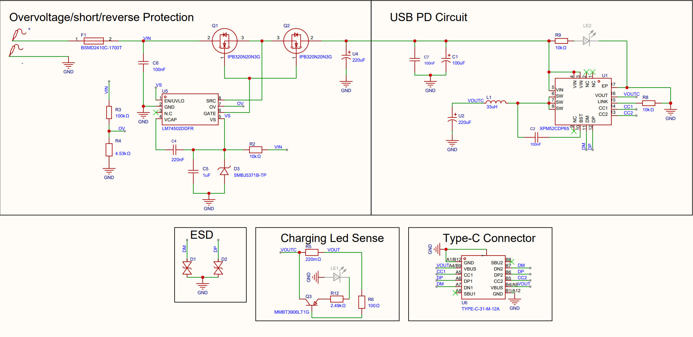
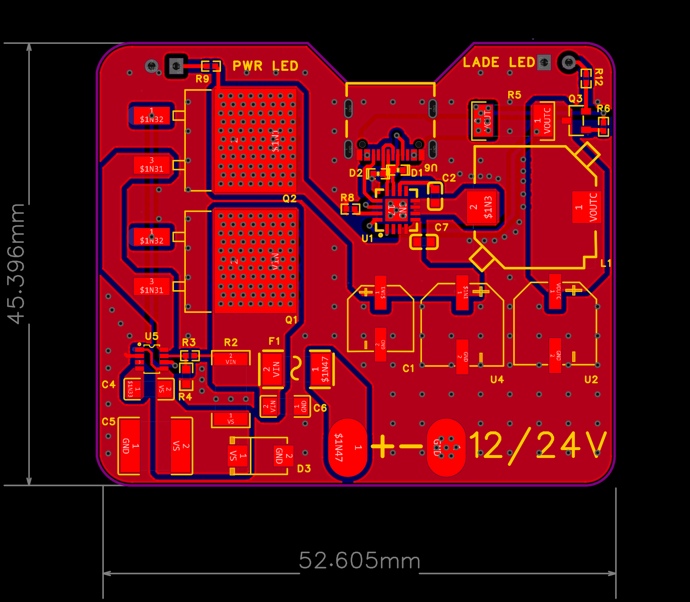

# Automotive-USB-PD

This is a 52x45mm USB-PD module 
This project was made to add a USB-PD fast charge to automobiles that doesnt offer one . Importand for eg. Ambulances..

# Render

# Schematics

# PCB

# Features
-12/24V Input 

-Voltage Spike protection up to 200V+

-USB-PD fast charge , 5/9/12V (20V if Input Voltage =>20V)

# Building/Ordering and customizing

- Total price listed in [BOM.MD](BOM.md)
- EasyEDA project [file](src/EasyEDA/USB-PD.epro2)
- Schematic [pdf](src/USB_PD_SCH.pdf)

# DISCLAMER ! This design is untested !

