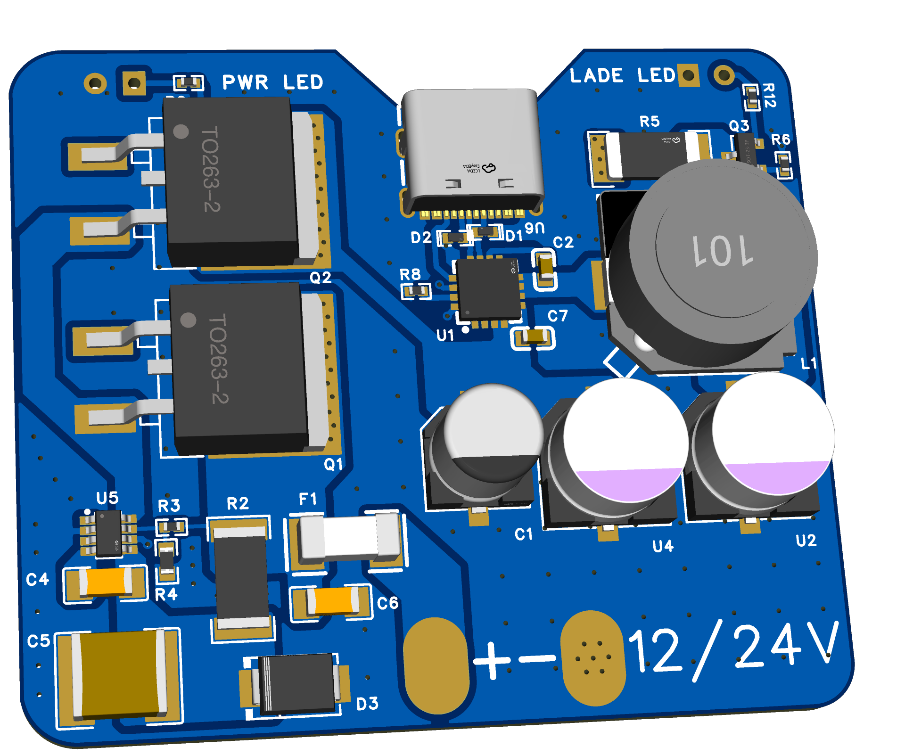

# Automotive-USB-PD

This is a 52x45mm USB-PD module 

# Features
-12/24V Input 

-Voltage Spike protection up to 200V+

-USB-PD fast charge , 5/9/12V (20V if Input Voltage =>20V)

Files :

[BOM  ](USBPD_BOM.csv)

[GERBER  ](USBPD_GERBER.zip)

[PICK & PLACE  ](USBPD_PPF.xlsx)

[STEP  ](USBPD.step)

This project was made to add a USB-PD fast charge to automobiles that doesnt offer one . Importand for eg. Ambulances..

# DISCLAMER ! This design is untested !

